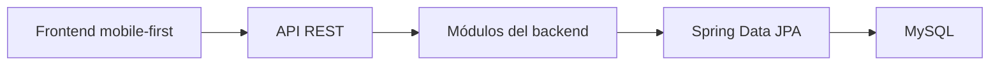

# Arquitectura del sistema

## Decisión principal

SalvemosLaComida utilizará una arquitectura de **monolito modular organizado por capas**.

Habrá un solo backend desplegable y una sola base de datos. El código se separará internamente por áreas del negocio para evitar que todas las clases terminen mezcladas.

Esta solución es suficiente para el alcance académico y permite que los cinco integrantes trabajen sobre módulos reconocibles sin introducir la complejidad de los microservicios.

## Tecnologías

| Componente | Tecnología |
|---|---|
| Lenguaje backend | Java 21 |
| Framework backend | Spring Boot |
| Construcción y dependencias | Maven |
| Persistencia | Spring Data JPA |
| Base de datos | MySQL |
| Frontend | HTML, CSS y JavaScript |
| Estilos | Tailwind CSS |
| Comunicación | API REST sobre HTTP |

La versión exacta de Spring Boot se registrará en este documento cuando se genere el proyecto base.

## Módulos propuestos

| Módulo | Responsabilidad |
|---|---|
| `identidad` | Usuarios, perfiles, empresas, establecimientos y cuentas operativas. |
| `afiliacion` | Solicitudes, documentos, revisiones, aprobaciones y suspensiones. |
| `ofertas` | Packs, ofertas, variantes, alérgenos y restricciones. |
| `reservas` | Stock, reservas, pagos, boletas, códigos, recojos, cancelaciones y comisiones. |
| `experiencia` | Reseñas, notificaciones e impacto ambiental. |
| `shared` | Configuración y componentes técnicos reutilizados por varios módulos. |

Las 31 clases y sus razones están explicadas en [MODELO_DOMINIO.md](decisiones/MODELO_DOMINIO.md).

## Capas dentro de cada módulo

| Capa | Responsabilidad |
|---|---|
| `controller` | Recibe solicitudes HTTP, valida la entrada básica y devuelve respuestas. |
| `service` | Coordina los casos de uso y aplica las reglas del negocio. |
| `repository` | Consulta y guarda información mediante JPA. |
| `domain` | Contiene las clases y reglas propias del negocio. |
| `dto` | Transporta datos de entrada y salida sin exponer directamente las entidades. |

## Reglas de dependencia

- El frontend nunca accederá directamente a MySQL.
- Un controller delegará las operaciones al service.
- Los controllers no contendrán decisiones importantes del negocio.
- Los repositories no decidirán reglas de cancelación, stock o aprobación.
- El dominio no dependerá del frontend.
- Las funciones compartidas no deben convertirse en un lugar para colocar código sin organización.
- Una comunicación entre módulos deberá realizarse mediante servicios claros, no accediendo indiscriminadamente a sus repositories.
- Las operaciones que afecten reserva, pago y stock deberán ejecutarse mediante transacciones.

## Organización prevista del backend

```text
backend/
└── src/
    ├── main/
    │   ├── java/com/salvemoslacomida/
    │   │   ├── identidad/
    │   │   ├── afiliacion/
    │   │   ├── ofertas/
    │   │   ├── reservas/
    │   │   ├── experiencia/
    │   │   └── shared/
    │   └── resources/
    └── test/
```

Cada módulo podrá contener las capas que realmente necesite. No se crearán carpetas vacías únicamente para cumplir una forma visual.

## Comunicación general



## Seguridad y privacidad inicial

- Las cuentas administrativas no tendrán registro público.
- Los accesos se limitarán según el perfil del usuario.
- Las contraseñas deberán almacenarse de forma segura.
- Los archivos de los establecimientos serán privados.
- El consumidor solo verá el estado de verificación, no los documentos originales.
- No se guardarán credenciales ni secretos dentro del repositorio.

## Alcance del primer avance

Para el primer avance se necesita:

- Proyecto Spring Boot configurado.
- Estructura modular básica.
- Clases de dominio iniciales.
- Configuración de persistencia preparada.
- Comprobación de que el backend inicia correctamente.

No es necesario tener implementados todos los controllers, servicios REST, pagos o flujos completos en esta etapa.
