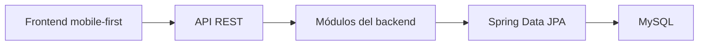

# Arquitectura del sistema

## Decisión principal

MealFlow utilizará una arquitectura de **monolito modular organizado por capas**.

Habrá un solo backend desplegable y una sola base de datos. El código se separará internamente por áreas del negocio para evitar que todas las clases terminen mezcladas.

Esta solución es suficiente para el alcance académico y permite que los cinco integrantes trabajen sobre módulos reconocibles sin introducir la complejidad de los microservicios.

## Tecnologías

| Componente | Tecnología |
|---|---|
| Lenguaje backend | Java 21 |
| Framework backend | Spring Boot 4.1.1 |
| Construcción y dependencias | Maven |
| Persistencia | Spring Data JPA |
| Base de datos oficial | MySQL |
| Base de datos de desarrollo | H2 |
| Frontend | HTML, CSS y JavaScript |
| Estilos | Tailwind CSS |
| Comunicación | API REST sobre HTTP |

El proyecto base utiliza Spring Boot 4.1.1 y Java 21. Durante el desarrollo inicial se usa H2 en memoria para realizar comprobaciones rápidas; MySQL continúa siendo la base de datos oficial para la integración y la entrega final.

## Dependencias del backend

Maven utiliza dos tipos de dependencias:

- **Directas:** aparecen declaradas expresamente en el `pom.xml`.
- **Transitivas:** son incorporadas automáticamente por una dependencia directa. No están ocultas ni deben copiarse una por una en el `pom.xml`.

### Dependencias directas

| Dependencia | Uso en MealFlow | Alcance |
|---|---|---|
| Spring Web MVC | API REST, controladores, conversión JSON y servidor web. | Aplicación |
| Spring Data JPA | Persistencia mediante JPA, Hibernate y repositories. | Aplicación |
| Spring Validation | Validación de los datos recibidos por formularios y endpoints. | Aplicación |
| MySQL Connector/J | Conexión JDBC con la base de datos oficial MySQL. | Ejecución |
| H2 Database | Base de datos en memoria para desarrollo y pruebas rápidas. | Ejecución |
| Lombok | Reducción controlada de código repetitivo en las clases Java. | Opcional |
| Spring Boot DevTools | Reinicio rápido y ayudas durante el desarrollo. | Opcional |
| Spring Boot Starter Test | Pruebas con JUnit Jupiter, Mockito y AssertJ. | Pruebas |

Las versiones compatibles son administradas por Spring Boot 4.1.1. Los identificadores técnicos se mantienen en el `pom.xml`; no se declararán versiones individuales salvo que exista una necesidad técnica comprobada.

### Dependencias transitivas principales

| Componente incorporado | Dependencia directa que lo aporta | Función |
|---|---|---|
| Spring Framework 7.0.9 y Spring MVC | Spring Web MVC | Controladores, inyección de dependencias y procesamiento HTTP. |
| Apache Tomcat 11.0.24 | Spring Web MVC | Servidor HTTP embebido en el backend. |
| Jackson 3.1.5 | Spring Web MVC | Conversión entre objetos Java y JSON. |
| Hibernate ORM 7.4.5.Final | Spring Data JPA | Implementación de JPA y generación de operaciones SQL. |
| Spring Data JPA 4.1.1 | Spring Data JPA | Creación de repositories y consultas de persistencia. |
| HikariCP 7.0.2 | Spring Data JPA | Administración eficiente de conexiones a la base de datos. |
| Hibernate Validator 9.1.3.Final | Spring Validation | Ejecución de las reglas de validación. |
| SLF4J y Logback | Spring Boot | Registro de mensajes, advertencias y errores. |
| JUnit Jupiter, Mockito y AssertJ | Spring Boot Starter Test | Pruebas automatizadas. |

Esta tabla registra los componentes principales que el equipo debe conocer; no intenta repetir cada archivo JAR descargado. El árbol completo y vigente puede consultarse desde la carpeta del backend con `mvnw.cmd dependency:tree` en Windows o `./mvnw dependency:tree` en Linux y macOS.

## Módulos propuestos

| Módulo | Responsabilidad |
|---|---|
| `identidad` | Usuarios, perfiles, empresas, establecimientos y cuentas operativas. |
| `afiliacion` | Solicitudes, documentos, revisiones, aprobaciones y suspensiones. |
| `ofertas` | Packs, ofertas, variantes, alérgenos y restricciones. |
| `reservas` | Retenciones de stock, reservas, detalles, códigos de recojo y entregas. |
| `transacciones` | Pagos, boletas simuladas, cancelaciones, reembolsos y comisiones. |
| `experiencia` | Reseñas, notificaciones e impacto ambiental. |
| `shared` | Configuración y componentes técnicos reutilizados por varios módulos. |

## Propiedad funcional de los módulos

| Módulo | Responsable principal |
|---|---|
| `identidad` | Emanuel |
| `afiliacion` | Daniel |
| `ofertas` | Franco |
| `reservas` | Piero |
| `transacciones` | Alejandro |
| `experiencia` | Alejandro |

Cada responsable conoce y modifica las clases de su módulo. Los demás módulos pueden relacionarse con ellas mediante asociaciones y servicios acordados, pero no cambiarán su funcionamiento interno sin coordinación.

El módulo `shared` no pertenece a un rubro del negocio. Sus cambios técnicos deberán ser revisados por Daniel y Franco para evitar que se convierta en una carpeta de código mezclado.

Las 31 clases y sus razones están explicadas en [MODELO_DOMINIO.md](decisiones/MODELO_DOMINIO.md).

## Capas dentro de cada módulo

| Capa | Responsabilidad |
|---|---|
| `controller` | Recibe solicitudes HTTP, valida la entrada básica y devuelve respuestas. |
| `service` | Coordina los casos de uso y aplica las reglas del negocio. |
| `repository` | Consulta y guarda información mediante JPA. |
| `domain` | Contiene las clases y reglas propias del negocio. |
| `dto` | Transporta datos de entrada y salida sin exponer directamente las entidades. |

## Reglas de dependencia

- El frontend nunca accederá directamente a MySQL.
- Un controller delegará las operaciones al service.
- Los controllers no contendrán decisiones importantes del negocio.
- Los repositories no decidirán reglas de cancelación, stock o aprobación.
- El dominio no dependerá del frontend.
- Las funciones compartidas no deben convertirse en un lugar para colocar código sin organización.
- Una comunicación entre módulos deberá realizarse mediante servicios claros, no accediendo indiscriminadamente a sus repositories.
- Una relación entre clases de módulos diferentes no cambia la propiedad de esas clases.
- Los cambios que afecten el contrato entre dos módulos deberán ser revisados por ambos responsables.
- Las operaciones que afecten reserva, pago y stock deberán ejecutarse mediante transacciones.

## Organización prevista del backend

```text
backend/
└── src/
    ├── main/
    │   ├── java/com/mealflow/
    │   │   ├── identidad/
    │   │   ├── afiliacion/
    │   │   ├── ofertas/
    │   │   ├── reservas/
    │   │   ├── transacciones/
    │   │   ├── experiencia/
    │   │   └── shared/
    │   └── resources/
    └── test/
```

Cada módulo podrá contener las capas que realmente necesite. No se crearán carpetas vacías únicamente para cumplir una forma visual.

## Comunicación general



## Seguridad y privacidad inicial

- Las cuentas administrativas no tendrán registro público.
- Los accesos se limitarán según el perfil del usuario.
- Las contraseñas deberán almacenarse de forma segura.
- Los archivos de los establecimientos serán privados.
- El consumidor solo verá el estado de verificación, no los documentos originales.
- No se guardarán credenciales ni secretos dentro del repositorio.

## Alcance del primer avance

Para el primer avance se necesita:

- Proyecto Spring Boot configurado.
- Estructura modular básica.
- Clases de dominio iniciales.
- Configuración de persistencia preparada.
- Comprobación de que el backend inicia correctamente.

No es necesario tener implementados todos los controllers, servicios REST, pagos o flujos completos en esta etapa.
