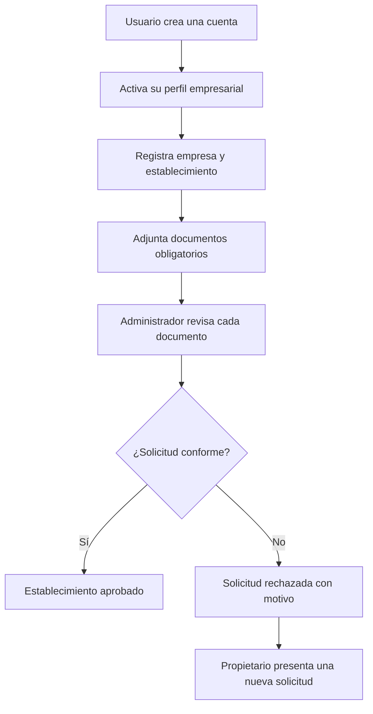
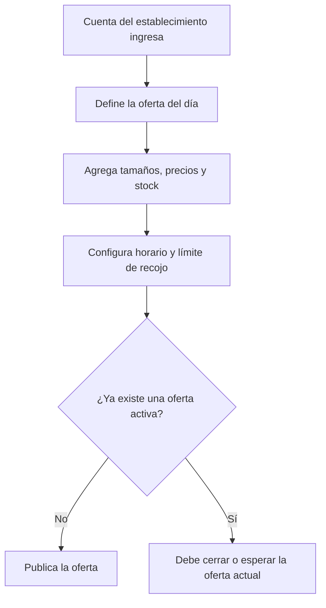
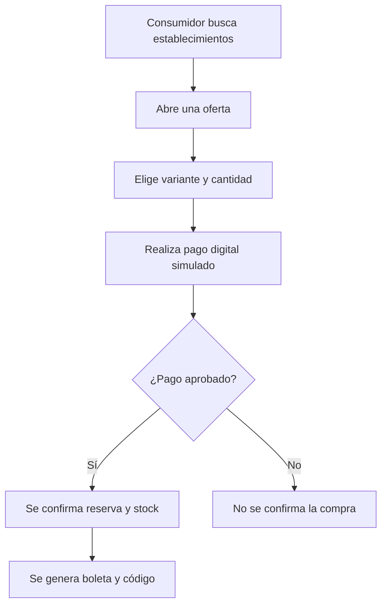
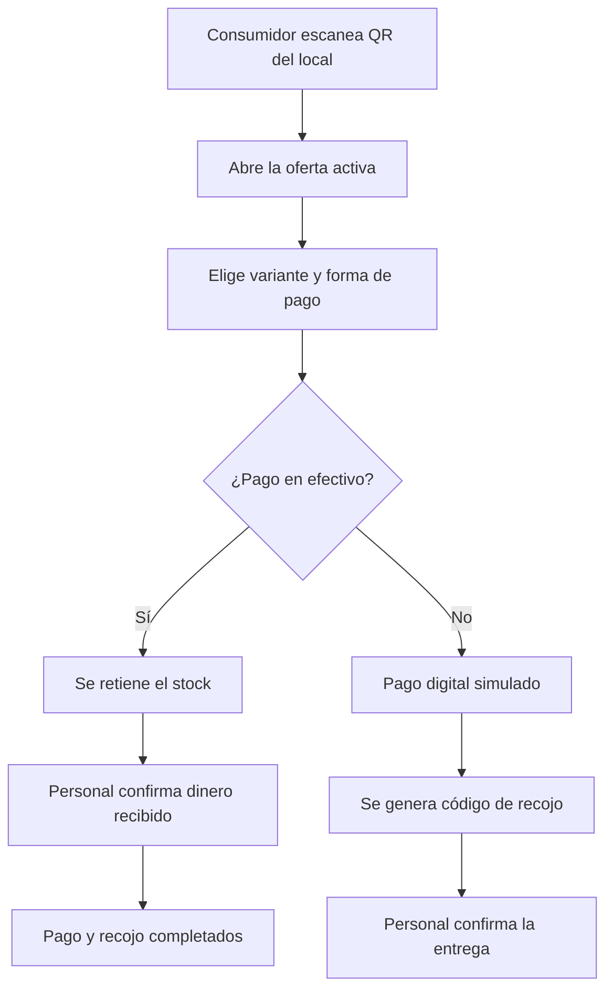
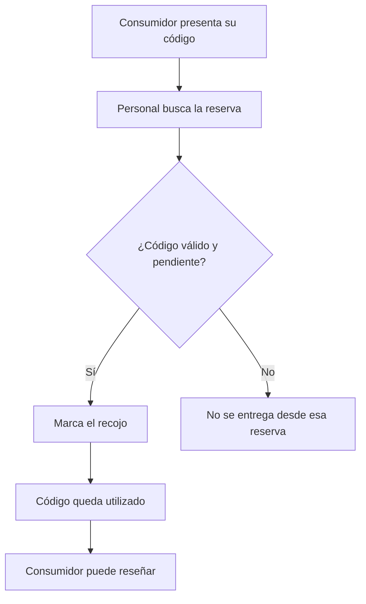
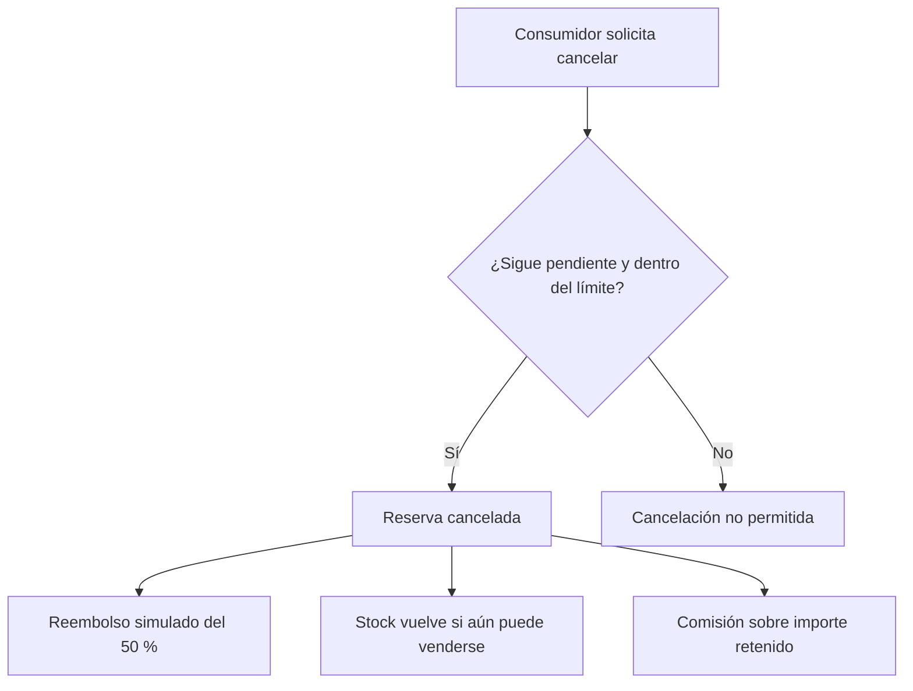
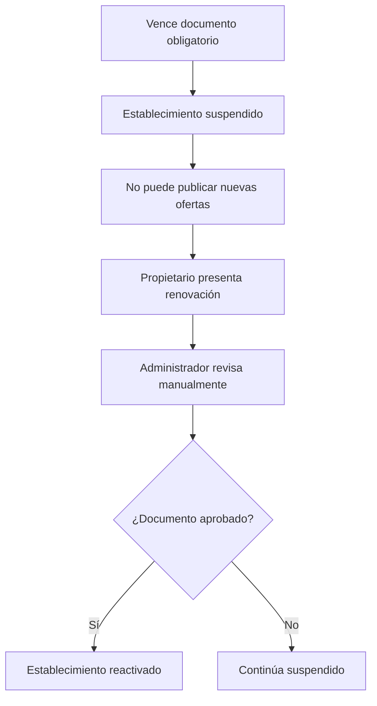

# Flujos principales del negocio

Este documento explica cómo interactúan los usuarios con la plataforma. Describe el comportamiento esperado de Sazloop, no una implementación terminada. Los 26 RF corregidos se mantienen en [REQUISITOS.md](requisitos/REQUISITOS.md); la ejecución de estos flujos no está acreditada por los prototipos.

## 1. Registro y afiliación de un establecimiento

Reglas principales:

- Los documentos se evalúan por establecimiento.
- El administrador realiza la revisión manualmente.
- Un rechazo no elimina la cuenta, la empresa ni el establecimiento.
- La cuenta operativa del local se crea después de su aprobación.

## 2. Publicación de una oferta

El establecimiento puede mantener la descripción general de su pack, pero solo tendrá una oferta activa simultáneamente. Cada tamaño funciona como una variante con precio y stock propios.

## 3. Compra remota

Reglas principales:

- Los medios remotos son tarjeta de débito simulada y Yape simulado.
- La reserva y la actualización definitiva del stock se ejecutan de forma consistente.
- El contenido exacto del pack continúa siendo sorpresa.

## 4. Compra presencial mediante QR

El efectivo solo está disponible para una compra presencial. La retención temporal evita vender las mismas unidades a otra persona mientras el personal confirma el cobro.

## 5. Confirmación del recojo y reseña

Pagar no equivale a recibir el pack. El recojo es el hecho que cierra correctamente la compra y habilita la calificación.

## 6. Cancelación de una reserva remota

No se puede cancelar una reserva ya recogida, cancelada o expirada. Las compras presenciales completadas no tienen cancelación mediante la plataforma.

## 7. Vencimiento de un documento

La suspensión conserva la cuenta, el historial y la información del establecimiento. Las reservas pagadas antes de la suspensión deben ser atendidas.
